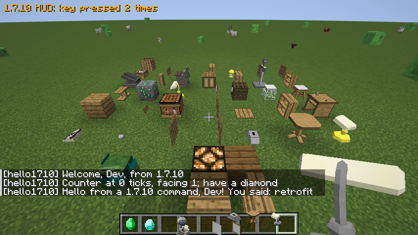

# Retrofit

Play Minecraft 1.7.10 Forge mods inside Minecraft 1.20.1 (Forge 47).

Retrofit runs a real copy of Minecraft 1.7.10 and Forge 10.13.4 inside the 1.20.1 game, in an
isolated class loader, and bridges it to the 1.20.1 world, renderer and network. Legacy mods run
their own 1.7.10 code; their blocks, items, tile entities, GUIs, entities, recipes, world
generation, sounds, commands and packets show up as ordinary 1.20.1 content. Retrofit ships no
Mojang code and no mod code: 1.7.10 and Forge come from the player's launcher install or are
downloaded from Mojang and Forge on first start (checksum-verified), and players supply their own
1.7.10 mods. Retrofit is free, with no paid tiers.

**Status: 0.2.0-alpha.** See [Compatibility](#compatibility) for what works and what doesn't.



## Using it

1. Install Forge 1.20.1 (47.x) and put `retrofit-forge-0.2.0-alpha.jar` in `mods/`.
2. Put 1.7.10 Forge mod jars in `retrofit/mods/` inside the game directory (created on first start).
3. Start the game. The first start downloads Minecraft 1.7.10, Forge 10.13.4.1614 and their
   libraries (a few tens of MB) unless the launcher already has them; every start then spends about
   5-10 seconds booting 1.7.10 during mod loading.

Servers: the same, on a Forge 1.20.1 server. Clients and the server need the same 1.7.10 mods;
connecting with a different set is refused with a message. Java 17 or newer (tested with 17, 21 and 26).

## Compatibility

### Tested mods

Every mod below was run through the automated mod sweep (see [Building](#building)) in a new
1.20.1 world. The sweep places every block variant, right-clicks every machine, spawns and kills
every creature, carries every item and generates new chunks. All of them were also loaded
together, in singleplayer and on a dedicated server with a client connected.

| Mod (version tested) | Result |
|---|---|
| BiblioCraft 1.11.7 | Works: all 246 block variants with their models, 49 GUIs, sounds, paintings |
| Iron Chests 6.0.62 | Works: all chests with their renderers and GUIs, upgrades |
| Thaumcraft 4.2.3.5 (+ Baubles 1.0.1.10) | Works: blocks and their models, 50 creatures, items, wands, ores and trees in world generation, the Outer Lands dimension with its eldritch maze |
| Witchery 0.24.1 | Works: blocks, 55 creatures, brews, items, brooms and other mounts, world generation, the Spirit World, Torment and Mirror dimensions |
| OreSpawn 1.7.10-20.3 | Works: 134 creature types, items, ores and structures, natural spawning |
| Mo' Creatures 6.3.1 (+ CustomMobSpawner 3.3.0) | Works: 61 creatures with their models, riding, natural spawning, the Wyvern Lair dimension |
| RotaryCraft V33a (+ DragonAPI V33b) | Works: machines, renderers, GUIs, 993 items. On a dedicated server, add the JVM argument `-DragonAPI_silence_ASM_POTIONPACKETID1` (a DragonAPI patch that only works on clients) |
| Ars Magica 2 1.4.0.009 (+ AnimationAPI 1.2.4) | Works: blocks, 18 machine GUIs, 36 creatures, spells, flight, the air sled, the power network, world generation |
| Tinkers' Construct 1.8.8 (+ Mantle 0.3.2b) | Works: tools and parts with their names and textures, smeltery blocks, 35 GUIs, ores |
| Pam's HarvestCraft 1.7.10Lb | Works: crops, food, gardens, machines and their GUIs |
| Carpenter's Blocks 3.3.8.2 | Works: blocks render in place in the world (slopes, stairs, doors...) |
| Chisel 2.9.5.11 | Works: all 1,373 variants including connected textures, the chisel GUI, marble and limestone generation |
| BuildCraft 7.1.27 | Works: engines, machines, GUIs, oil and fuel; vanilla chests and furnaces are inventories to its pipes. Robots need their dock |
| IndustrialCraft 2 2.2.828 | Works: machines with their textures, 72 machine GUIs, cables, ores, crops |
| Lycanite's Mobs 1.13.0.5 | Works: 110 creatures across all its sub-mods, natural spawning |
| CodeChickenCore 1.4.22 + NotEnoughItems 2.8.160 (GTNH) | Loads and runs (coremods). NEI's item panel only appears on 1.7.10 screens; use JEI on 1.20.1 screens |

1.7.10 mods' own config files are in `retrofit/config`. ID clashes between mods are the same as
in a 1.7.10 pack. For example, Witchery and RotaryCraft both use potion ID 35 by default, and
DragonAPI then refuses to start until one is changed there.

### What works

| Area | What works | Limits |
|---|---|---|
| Blocks | Mod blocks with metadata, shapes and collision, hardness, tools and tool tiers (as 1.20.1 tags), sounds, light, redstone and comparators, random and scheduled ticks, neighbour updates, right/left click, placing through the mod's own ItemBlock, breakBlock, drops (fortune, silk touch), experience, fluid blocks | Shapes that depend on neighbours use their stand-alone form for collision |
| Rendering | Plain cubes as 1.20.1 JSON models with the mods' own 1.7.10 textures (animated ones too, sprite sheets and mods' own sprite loaders); custom block renderers drawn in place in the world, with their neighbours and tile entity (connected textures, covers, pipes); tile entity renderers and Forge item renderers every frame through a GL 1.1 emulation | Only the GL subset models need; mods' shaders run as plain drawing |
| Tile entities | Ticking on both sides, NBT saving, description packet sync, chunk unload, inventories as Forge item handlers (hoppers, pipes); vanilla and modern inventories as 1.7.10 tile entities for legacy pipes and machines | |
| Items | Subtypes, the mods' own item names, durability, use on blocks and in the air (either hand), use over time (food, bows), mining speed and harvest checks, weapon damage, inventory ticks, fuel, enchantments (mods' own become 1.20.1 enchantments), each mod's own creative tab | Items used over time work in the main hand only |
| Armor | Real 1.20.1 armor with the legacy texture, armor points and onArmorTick | Dyeable and special armor models |
| GUIs | Container GUIs (FML openGui, and containers mods open themselves, as IC2 does) with the mod's own drawing, slots, shift-click, drag, progress bars and buttons; plain screens; mod packets from GUIs | |
| Entities | Mod creatures and things with their own AI and pathfinding, damage both ways, death and drops, saving, the mod's own renderer, spawn eggs, natural spawning from the 1.7.10 biome lists, riding (the player on legacy mounts, legacy creatures on each other); vanilla entities legacy code spawns (arrows, mobs) become 1.20.1 ones; 1.7.10 spawn setup (equipment, variants) for mobs 1.20.1 spawns | 1.7.10 code assumes y >= 0 (pathfinding below 0 fails) |
| Players | Legacy code sees a real EntityPlayerMP/EntityClientPlayerMP mirror: inventory, food, health, flight, chat, teleports, damage from legacy mobs, permission levels, potion effects both ways (mod potions' attribute modifiers too), extended properties saved with the player; FakePlayers | Player model and render events |
| World | Mod world generators (ores, structures, generated chests), world saved data, chunk load/unload/data events with per-chunk mod data, chunk access, per-world id maps (stable when mods change), mods' dimensions as 1.20.1 dimensions (their generators, creatures, fog and sky colours, Teleporters), ForgeChunkManager chunk loading | Generation is serialized |
| Recipes | Every crafting recipe (through the legacy recipe list, mods' own recipe classes included), furnace recipes, fuel; shaped and shapeless crafting recipes (vanilla and Ore Dictionary ones) in the recipe book, JEI, REI and EMI | Recipes of mods' own recipe classes (IC2's, Tinkers' tools) craft but don't show in the recipe book or viewers |
| Events | FML ticks (server, world, player, client, render), login/logout/respawn/dimension, server lifecycle, PlayerInteractEvent, living events (attack, hurt, death, fall, jump, heal, break speed, update), EntityJoinWorldEvent, item tooltips, world load/save, chunk events, texture stitching, key bindings and KeyInputEvent, HUD (RenderGameOverlayEvent.Post), RenderWorldLastEvent | Other Forge events (block highlight, render player...) |
| Commands | Commands registered in FMLServerStartingEvent, with tab completion; usable from command blocks and data pack functions | |
| Achievements | Mods' achievements as advancements, a tab per achievement page | |
| Sounds | Mod sounds.json and .ogg files; common 1.7.10 vanilla sound names mapped | |
| Network | SimpleNetworkWrapper, FMLEventChannel and raw custom payloads, all targets; clients and servers with different legacy mods refuse each other | |
| With 1.20.1 mods | Energy (RF and IC2 EU <-> Forge Energy, both ways, IC2's energy net included), items (1.20.1 items in legacy inventories, pipes, machines and recipes; Ore Dictionary <-> tags), fluids (every legacy fluid is a 1.20.1 fluid and back; tanks both ways), creatures (legacy mobs target and fight 1.20.1 creatures and the reverse; legacy magnets pick up 1.20.1 items), blocks (1.20.1 mods' blocks drop and break right for legacy quarries and miners) | IC2's energy net gets 1.20.1 energy at low voltage (32 EU/t per block) |
| Coremods | Loaded as 1.7.10 did, in FML's order (CodeChickenCore, DragonAPI, Ars Magica 2's, IC2's, Thaumcraft's); their patches apply to the legacy side | |
| Java 17+ | 1.7.10 mods' Java 8 tricks work: opening JDK members (setAccessible), writing final fields (Field.modifiers, also on Java 18+), enlarging the potion and biome arrays, coremods defining classes; ASM 5.2 instead of 5.0.3; short network timeouts for dead update servers | |

## Known issues

- A client sometimes stalls at "Logging in..." when connecting very soon after the game starts
  (it never answers the server's first Forge login query). It also happens without Retrofit;
  cancel and connect again.
- The first start without a 1.7.10 launcher install needs internet access to Mojang and Forge.
- Legacy dimensions use the overworld's sky renderer with the provider's colours; mods' own sky
  renderers (`WorldProvider.getSkyRenderer`) aren't drawn.
- FML logs "missing any signature data", and some mods log signature warnings. Cosmetic.

## How it works

- **Boot** (`legacy-boot`, `host`): LaunchWrapper's startup loop is reimplemented for Java 17;
  FML's tweakers run in a `RetrofitLaunchClassLoader`. Java 17 fixes: Pack200 (commons-compress,
  fetched at first start), no SecurityManager, final-field writes through Unsafe, console and
  system properties kept away from the host. Log4Shell-vulnerable log4j 2.0-beta9 is never
  loaded: legacy logs go through log4j-api 2.19 to the host's SLF4J.
- **World bridge** (`legacy-bridge`, generated by `tools/gen_worlds.py`): each 1.20.1 level has a
  real 1.7.10 `WorldServer`/`WorldClient` whose block, light, redstone, entity, sound and particle
  methods call the level through `retrofit.api.HostWorld`. A real (never started) legacy
  `MinecraftServer` holds the player list and commands. Vanilla 1.7.10 blocks map to 1.20.1
  blocks through Minecraft's own data fixer, items likewise.
- **Players**: legacy code always sees a mirror player, synced around every legacy call; only the
  inventory slots legacy code changed are written back.
- **Rendering**: LWJGL 2 references go to generated stand-ins; GL11 calls are emulated and
  captured as quads the host draws with its own render types (any GL profile, shaders mods work).
  GUIs draw the same way, with 1.20.1 drawing slot items and tooltips at markers the legacy code
  leaves in the capture.
- **Network**: FML's outbound handler is redirected to one 1.20.1 channel (`retrofit:legacy`);
  inbound packets are handed to the same legacy channel.
- **Data**: a built-in client resource pack (models, textures, translations, sounds) and a
  built-in data pack (tool tags, smelting recipes, world generation, spawns) are generated from the
  legacy mods at start.
- Legacy code that throws is contained: the block, tile entity, entity or event is reported once
  in the log and skipped, never crashing the game.

## Building

JDK 17 (pinned in `gradle.properties`).

| Module | Java | Purpose |
|---|---|---|
| `legacy-boot` | 8 bytecode | Bootstrap, Java 17 fixes, transformers, GL emulation, LWJGL 2 stand-ins |
| `bridge-api` | 8 bytecode | Interfaces between the two sides (`retrofit.api`) |
| `legacy-bridge` | 8 bytecode | The legacy side of the bridge (worlds, players, GUIs, entities, events) |
| `host` | 17 | Finds or downloads 1.7.10 and Forge, builds the isolated loader, boots it |
| `forge` | 17 | The Forge 1.20.1 mod |
| `harness` | 17 | Standalone boot, render and compatibility tests |
| `testmods/hello1710` | 8 bytecode | The 1.7.10 test mod |

```
./gradlew :forge:build                 # forge/build/libs/retrofit-forge-0.2.0-alpha.jar
./gradlew :harness:run                 # boot test + compatibility report for mods in corpus/
./gradlew :forge:runClient "-PquickPlay=New World" -PworldTest   # automated world test (singleplayer)
./gradlew :forge:runServer -PworldTest                          # automated world test, dedicated server...
./gradlew :forge:runClient -PtestServer=127.0.0.1:25565 -PworldTest   # ...and its client
./gradlew :forge:runClient -PmodSweep -Pcorpus=thaumcraft,baubles   # mod sweep (below) for some corpus mods
python -I tools/check_server_side.py   # after :harness:dumpServerSrgJar: no client-only 1.7.10 calls on servers
```

Dev runs load the 1.7.10 mods in `corpus/` (not in git; `.jar` and `.zip`). `-Pcorpus=a,b` picks
the ones whose file names contain one of the parts, `-Pcorpus=none` only the test mod.
`-PextraJvmArg=...` passes a JVM argument to the game (for example DragonAPI's flag).

The world test places, uses, eats and breaks legacy blocks and items, crafts and smelts, opens
the test mod's and BiblioCraft's GUIs, clicks a legacy button that sends a packet, fights a legacy
mob, runs a legacy command and world generator, presses a legacy key, and saves screenshots to
`forge/run/screenshots`. The dev server (`forge/run-server`, offline mode, flat world) accepts
Mojang's EULA for itself in its build step.

The mod sweep (`-PmodSweep`) creates a new normal world and exercises every legacy block variant
(placed and ticked), every machine (right-clicked, screenshot of each GUI), every creature
(spawned, watched for 10 seconds, killed), every item (carried in the inventory) and fresh chunks
(generated and scanned for mod blocks). It logs `[ModSweep]` results by mod and saves
`sweep-*.png` screenshots.

Legacy-side code compiles against `run/legacy-srg/*.jar`, which `:harness:dumpSrgJar` (and
`dumpServerSrgJar`) build from your own install. They contain Mojang code: local only, never
committed or published. Real 1.7.10 mods for testing go in `corpus/` (not in git).

## License

All Rights Reserved for now; the author will choose a license.
