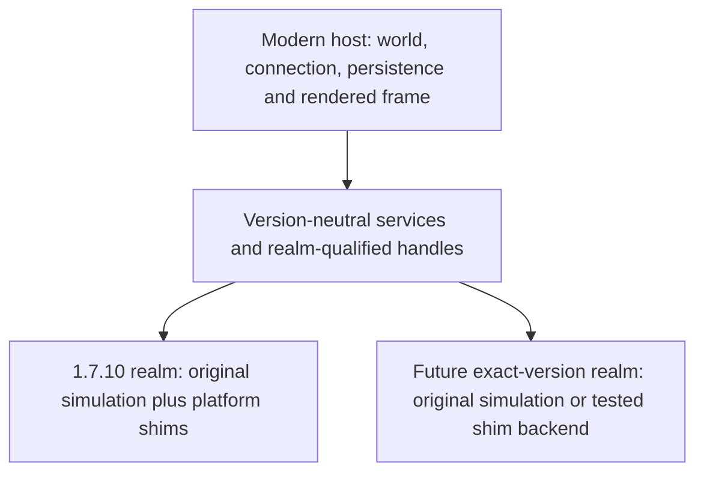

# Multi-version simulation/shim hybrid design review

2026-10-30. This is a proposed architecture for Retrofit, grounded in its current runtime and
an executable class-loader boundary fixture. It is not an announcement of 1.12.2 support.
No replacement Minecraft/Forge API tree or second-version backend has been added to 0.6.2-beta.

## Conclusion

A hybrid is feasible. Retrofit already combines original 1.7.10 simulation with platform shims
for Java compatibility, input, captured OpenGL and modern-world proxies. Preserve this working
backend, make its ownership boundary explicit, and add future backends through versioned host
services. Do not switch between native simulation and replacement behavior for individual calls
on the same mutable entity, inventory, world or player.

The important distinction is semantic ownership. A shim that links a missing method has not
necessarily reproduced its behavior. Original engine simulation preserves inherited mechanics
and coremod transformations; replacement APIs can simplify modern integration but must implement
and test those mechanics deliberately.

## Useful mechanisms for a future backend

| Mechanism | Proposed use | Constraint |
| --- | --- | --- |
| Explicit version realms | Keep exact game version, mappings, backend kind and mod set in a runtime key. | Similar SRG names do not establish equivalent behavior across 1.6.4/1.7.10 or 1.8/1.12.2. Begin with exact tested versions. |
| Library collision detection | Inventory classes/packages in each dependency island and include the result in cache fingerprints. | Two CodeChickenLib or shaded-API versions can have identical names and incompatible types. Never resolve a missing API from another version solely by class name. |
| Virtual field access | Rewrite supported field accesses to host-backed getters/setters inside a dedicated shim backend. | Reflection, native base methods, coremods and direct field access are different paths. Do not apply this rewrite globally to the original simulation realm. |
| Generated API surface | Use hierarchy/signature analysis to report gaps and provide narrowly defined non-gameplay fallbacks. | Null/default/no-op methods are not working inventory, damage, packet or dimension semantics. Gate capabilities and fail clearly when required behavior is missing. |
| Constructor adaptation | Consider only explicitly tested equivalent constructor signatures. | Picking a nearby constructor and filling missing arguments with defaults can change behavior without a linkage failure. |
| Optional integrations | Add neutral adapters for modern recipe viewers, accessories and tooltips. | Library replacement must account for direct/internal APIs, saved state and packets; do not remove working legacy libraries implicitly. |
| Shared platform services | Share neutral pixel/geometry output, input snapshots, sounds, resource lookup and Java compatibility utilities. | Realm-local graphics state, object caches and mutable engine state must stay isolated. |

## Game subsystem adaptation matrix

| Subsystem | Suitable hybrid boundary | Behavior that needs its own tests |
| --- | --- | --- |
| Worlds / blocks | A host-world service accepts positions, state IDs, metadata and realm-qualified handles. A shim backend can expose this as a legacy World view. | Keep original World methods/provider state in the simulation backend. Preserve redstone, scheduled ticks, light, collision and coordinate behavior. |
| Entities / attributes / AI | Pre-spawn state belongs to its realm; hosted entities use one simulation owner and explicit host interaction adapters. | No double tick, damage, healing or drops. Preserve inherited AI, modifiers, death sequences, data watchers and cross-version targeting. |
| Items / stacks / registries | Convert through a canonical host representation with realm provenance, count, damage and schema-tagged serialized data. | Same-named ItemStack classes are different types. Metadata/NBT and newer data components require version-specific conversion. |
| Inventories / screens | Host menus transport transaction state while each realm owns its native container and screen behavior. | Slot order, carried stack, revision checks, cancellation, rollback, death, save/reload and reconnect must remain server authoritative. |
| Networking | A version-qualified envelope routes original payload bytes to the correct main-thread decoder and side. | Include runtime/mod/registry fingerprints; a shared channel name is insufficient. Validate realm ownership and do not decode another version's bytes. |
| Events / player lifecycle | Adapt event order, cancellation and mutable results per exact version. | Forward clone/respawn/dimension events to the right player objects and preserve writeback; retain current inventory, fatigue and death checks. |
| Dimensions / terrain | Share host-level services while keeping providers, random state, generators and storage realm-local. | Do not apply two biome/generation pipelines to a chunk. Test terrain, structures, portals, lighting, spawns and round-trip state. |
| Rendering / textures | Use neutral captured geometry/pixels with version-specific model/input adapters. | Keep graphics state and caches local, initialize the viewer at the right stage, preserve alpha/light/color and validate buffer bounds. |
| Sound / physics | Share request transport while keeping game/mod physics policy in its backend. | Test exact gravity, fall damage, attenuation and dimension-specific sound behavior; modern defaults may differ. |
| Energy / fluids / recipes | Reuse host capability and transaction services with explicit unit/identity conversions. | Retrofit already has bidirectional energy/fluid bridges and native crafting. Fill measured gaps instead of adding a second authoritative implementation. |

## Current single-runtime blockers

- `RetrofitMod.runtime` is one global runtime. `LegacyBridge` holds one static method-handle map,
  one tick/prepareFrame set and one render lock; init stops once that map is populated. A second
  loader would currently route through the wrong entries. Introduce per-realm contexts first,
  retaining the existing default 1.7.10 route and save compatibility.
- The neutral `bridge-api` interfaces are already shared with the host by LegacyRootLoader.
  Their opaque Object arguments still belong to a particular loader. Only parent-owned neutral
  types and explicit conversions can cross realms; matching class names are not enough.
- World/entity/stack caches, native IDs, save maps, language tables, static singletons and render
  captures need realm ownership. Cache keys must include realm plus identity, not a method name,
  native integer ID or resource string alone. The tutorial landing fix illustrates why pre-transfer
  native fields must be captured before a host transition instead of being read after synchronization.
- The current network handshake describes one legacy mod set. Future handshakes need exact
  version, backend kind, mod hashes, mappings and registry fingerprint per realm.
- Preserve 0.6.2's existing persistent identifiers. Future realms require stable versioned identity
  translation and an explicit migration policy, not silent renaming of existing blocks or saves.
- Java and loader constraints differ between versions. Isolate incompatible ASM, libraries,
  static launch state and class transformers rather than exposing all versions through one loader.

## Ownership model

A dependency-connected mod set must use coherent class identity and backend behavior, including
subclasses, shared APIs, static registries and coremods. Versions coexist through host services,
not by sharing native object references. Every entity has exactly one simulation owner; the host
must not independently repeat equivalent AI/damage behavior.

Cross-version interactions use host-owned values and realm-qualified handles. Inventory and GUI
transactions remain server authoritative. Do not hold two realms' simulation/render locks while
calling arbitrary mod code. Use queued transactions or a documented lock order; player construction
and terrain callbacks already demonstrated the risk of shared global locks.

## Executed boundary fixture

`:host:checkRuntimeIsolation` loads the same fixture class name through two independent loaders.
The classes cannot cast each other's instances, static update counters remain independent, and
both implement a parent-owned neutral interface. This verifies the Java boundary constraint,
not a second Minecraft runtime or real cross-version mod compatibility. The fixture is test-only
and excluded from the player jar.

## Staged implementation sequence

1. Extract per-realm bridge/context ownership behind the current 1.7.10 calls without changing
   behavior. Require the existing gameplay, dedicated-server and save-upgrade checks to pass.
2. Add exact-version discovery, dependency islands, cache fingerprints and duplicate-mod-ID policy.
   Test incompatible copies of the same library and deterministic registration order.
3. Prototype a second backend in a private lab: one item, block, GUI, network interaction and
   save/reload. Verify dedicated-server/client separation and independent static state.
4. Test two realms together: placement, combat, inventories, fluids/energy, dimensions, rejoin,
   save migration and resource reload. Assert no duplicate ticks, damage or event delivery.
5. Add optional integrations separately, with exact-version compatibility evidence and clear
   diagnostics for incomplete capabilities.

This migration belongs after 0.6.2-beta stabilization. Replacing engine base classes before the
realm boundary is ready would discard inherited behavior and expand the regression surface.
Original game/mod code used by simulation realms remains private and is not redistributed.
